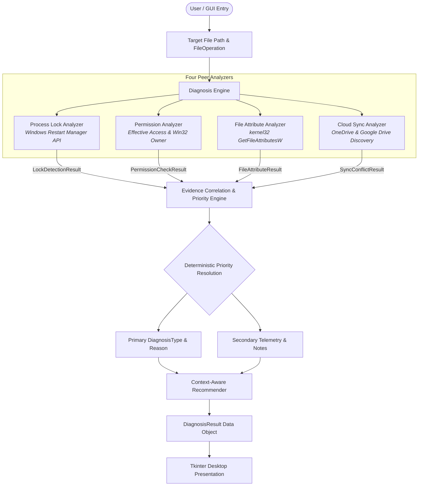

# File Operation Failure Diagnoser

A Windows-native systems diagnostics utility and Operating Systems Lab capstone project that inspects, correlates, and explains file access failures (`ERROR_ACCESS_DENIED`, `ERROR_SHARING_VIOLATION`) across multiple operating system contention vectors.

---

## 1. Project Overview & Objectives

When a user or application attempts to read, write, execute, or delete a file on Microsoft Windows, the operation may fail abruptly with opaque error codes such as **Win32 Error 5 (`ERROR_ACCESS_DENIED`)** or **Win32 Error 32 (`ERROR_SHARING_VIOLATION`)**. Standard Windows error dialogs typically state *that* an operation failed, but rarely reveal the precise root cause:
- Which background process holds an exclusive handle on the file?
- Does the current user account lack discretionary access rights (ACLs)?
- Is a DOS/NTFS `READONLY` attribute flag preventing write or deletion?
- Is an active cloud sync daemon (Microsoft OneDrive or Google Drive) locking the file during synchronization?

The **File Operation Failure Diagnoser** addresses this problem by querying four independent peer analyzers coordinated sequentially in one unified diagnosis pass, correlating the gathered evidence through a deterministic priority hierarchy, and presenting human-readable root-cause diagnoses alongside actionable, context-aware remediation advice.

### Core Operating Principles
1. **Strictly Diagnostic & Read-Only**: The application never terminates processes, modifies user files, closes handles forcefully, alters security descriptors, or performs destructive disk deletions.
2. **Evaluates Operation Semantics**: Access is evaluated against the requested operation (`READ`, `WRITE`, `EXECUTE`, `DELETE`). For example, a `READ_ONLY` attribute blocks `WRITE` and `DELETE`, but explicitly permits `READ` and `EXECUTE`.
3. **Four Peer Analyzers**: Process locks, access permissions, file attributes, and cloud synchronization are treated as independent telemetry channels.
4. **Deterministic Priority Resolution**: When multiple failure conditions coexist (e.g. an active lock on a read-only file), deterministic priority rules identify the primary cause while preserving secondary evidence in telemetry panels.
5. **Truthful Boundary Reporting**: The tool clearly reports what can and cannot be verified on the operating system without fabricating artificial successes or positive sync locks.

---

## 2. Feature Summary & Implementation Status

All core subsystems, peer analyzers, diagnostic engine rules, and GUI presentations are fully implemented and validated on Windows 11:

| Component / Subsystem | Implementation File | Status | Verification |
| :--- | :--- | :--- | :--- |
| **Data Models & Types** | `src/diagnoser/models.py` | Complete | Strongly typed dataclasses for all 4 analyzer results, operations, and diagnosis types. |
| **Process Lock Analyzer** | `src/diagnoser/analyzers/process_lock.py` | Complete | Native Windows Restart Manager API (`rstrtmgr.dll`) queries handle tables; `psutil` enriches process metadata. |
| **Permission Analyzer** | `src/diagnoser/analyzers/permissions.py` | Complete | `os.access()` evaluates current user rights; `advapi32.dll` resolves file owner SID. |
| **File Attribute Analyzer** | `src/diagnoser/analyzers/file_attributes.py` | Complete | Win32 `kernel32.GetFileAttributesW` bitmask inspection and operational impact evaluation. |
| **Cloud-Sync Conflict Analyzer** | `src/diagnoser/analyzers/sync_conflict.py` | Complete | Bounded local discovery for OneDrive and Google Drive with conservative 4-tier evidence classification. |
| **Context-Aware Recommender** | `src/diagnoser/recommendations/recommender.py` | Complete | Generates safe, specific guidance tailored to the primary diagnosis and secondary findings. |
| **Diagnosis Engine** | `src/diagnoser/engine/diagnosis.py` | Complete | Correlates all 4 peer analyzers and assigns deterministic root cause via 7 priority rules. |
| **Desktop GUI** | `src/diagnoser/gui/main_window.py` | Complete | Dark-themed Tkinter desktop interface with scrollable evidence cards, badges, and reset behavior. |
| **Teacher Demonstration Kit** | `artifacts/review3/demo_fixtures/teacher_demo/` | Complete | Reusable, non-destructive test fixtures and PowerShell attribute management scripts. |

---

## 3. Architecture

The application employs a layered, peer-analyzer architecture orchestrated by a central `DiagnosisEngine`:



---

## 4. The Four Peer Analyzers

### 1. Process Lock Analyzer (`src/diagnoser/analyzers/process_lock.py`)
- **Primary Mechanism**: Native Windows Restart Manager API (`rstrtmgr.dll`: `RmStartSession`, `RmRegisterResources`, `RmGetList`, `RmEndSession`).
- **Functionality**: Queries the OS handle table for active lockers. Returns holding process name, process ID (PID), application type, and executable path.
- **Process Enrichment**: Uses `psutil` solely to enrich process metadata (e.g. process creation time, full executable path, command-line arguments); `psutil` is **not** a substitute for Restart Manager lock detection.

### 2. Permission Analyzer (`src/diagnoser/analyzers/permissions.py`)
- **Primary Mechanism**: Python OS access checks (`os.access()`) combined with Win32 Security APIs (`advapi32.dll`: `GetNamedSecurityInfoW`, `LookupAccountSidW`).
- **Functionality**: Evaluates effective read, write, execute, and delete accessibility for the current user token and resolves the owning user/group account name.
- **Boundary Distinction & Limitations**: Evaluates effective user rights via standard C-Runtime checks and attribute status. It does **not** evaluate recursive NTFS Discretionary Access Control List (DACL) inheritance trees, nor does it parse directory-level deletion permissions for `DELETE`.

### 3. File Attribute Analyzer (`src/diagnoser/analyzers/file_attributes.py`)
- **Primary Mechanism**: Win32 File Attribute API (`kernel32.dll`: `GetFileAttributesW`).
- **Functionality**: Extracts raw attribute bitmasks and evaluates their operational consequences:
  - `FILE_ATTRIBUTE_READONLY` (`0x0001`): Blocks `WRITE` and `DELETE`; explicitly allows `READ` and `EXECUTE`.
  - `FILE_ATTRIBUTE_HIDDEN` (`0x0002`): Secondary attribute; does not block read/write operations.
  - `FILE_ATTRIBUTE_SYSTEM` (`0x0004`): Operating system file flag; evaluated safely without false alarms.
  - `FILE_ATTRIBUTE_ARCHIVE` (`0x0020`): Standard archive flag for modified files.
  - `FILE_ATTRIBUTE_REPARSE_POINT` (`0x0400`): Symlinks, junctions, or cloud placeholders (Cloud Files API).
  - `FILE_ATTRIBUTE_OFFLINE` (`0x1000`): Remote/cloud storage placeholder not stored locally on disk.

### 4. Cloud-Sync Conflict Analyzer (`src/diagnoser/analyzers/sync_conflict.py`)
- **Scope**: Strictly bounded to **Microsoft OneDrive** and **Google Drive**. Unsupported third-party providers (Dropbox, Box, iCloud) are explicitly out of scope.
- **Evidence Hierarchy**:
  - `none`: File is outside all detected cloud roots.
  - `path_only`: File is within a detected cloud sync root, but no sync daemon is running and no lock exists.
  - `potential_contention`: File is within a cloud sync root and the provider's daemon is actively running.
  - `confirmed_lock`: The locking process identified by Restart Manager matches a known sync client binary (`OneDrive.exe`, `GoogleDriveFS.exe`).
- **Integrity Rule**: Presence in a sync directory does **not** constitute a confirmed lock without active handle contention.

---

## 5. Diagnosis Engine & Deterministic Priority Rules

When diagnosing a target file, `DiagnosisEngine` correlates findings using a strict, deterministic priority order:

1. **Rule 1 — Nonexistent Target (`FILE_NOT_FOUND`)**:
   If the target file does not exist on disk, return `FILE_NOT_FOUND` immediately. Downstream analyzer checks are cleanly marked as skipped.
2. **Rule 2 — Active Process Lock (`FILE_LOCKED`)**:
   If Restart Manager detects one or more active holding processes (and the locking process is not a confirmed sync daemon), return `FILE_LOCKED`. Any coexisting read-only attribute or secondary finding is preserved in telemetry.
3. **Rule 3 — Confirmed Cloud-Sync Lock (`SYNC_CONFLICT`)**:
   If Restart Manager associates the active file lock with a supported cloud-sync daemon (`OneDrive.exe`, `GoogleDriveFS.exe`), return `SYNC_CONFLICT`.
4. **Rule 4 — Inspection Barrier vs. Proven Denial**:
   - If an analyzer encountered an inspection error (e.g. Restart Manager returning Win32 Error 5 `ERROR_ACCESS_DENIED`), but the Permission Analyzer independently proved the operation is denied, classify as `PERMISSION_DENIED` and retain the lock error as secondary evidence.
   - Otherwise, if an inspection error prevented diagnostic completion and no independent denial was proven, return `UNKNOWN_ERROR`.
5. **Rule 5 — Permission Denial (`PERMISSION_DENIED`)**:
   If the user's access rights evaluate to denied for the requested operation, return `PERMISSION_DENIED`.
6. **Rule 6 — Read-Only Attribute Restriction (`READ_ONLY`)**:
   If the target file has `FILE_ATTRIBUTE_READONLY` set and the requested operation is `WRITE` or `DELETE`, return `READ_ONLY`.
7. **Rule 7 — Unimpeded Access (`OPERATION_ALLOWED`)**:
   If no analyzer detected a contention condition, return `OPERATION_ALLOWED`.

---

## 6. Supported Operations & Diagnostic Semantics

The diagnoser supports four diagnostic access evaluations via the `FileOperation` enum:

| Operation | Diagnostic Semantics | Underlying Check | Windows Execution Guarantee |
| :--- | :--- | :--- | :--- |
| **`READ`** | Checks whether the file can be opened for reading. | `os.access(R_OK)` + Restart Manager handle check | The file is read safely; attributes like `READONLY` do not block `READ`. |
| **`WRITE`** | Checks whether the file can be modified. | `os.access(W_OK)` + `GetFileAttributesW` + Restart Manager | Diagnostic access check; never modifies or writes data to the file. |
| **`EXECUTE`** | Checks whether the user has execution rights. | `os.access(X_OK)` + file owner rights | Static permission check; **never** launches, executes, or spawns the target file. |
| **`DELETE`** | Checks whether the user can safely remove the file. | `os.access(W_OK)` + read-only attribute check | Diagnostic check only; **never** deletes or unlinks the file from disk. |

> **Important**: The application diagnoses access permissions; it does not perform the selected file operation.

---

## 7. Technology Stack & API Reference

- **Language & Runtime**: Python 3.10+ supported (Python 3.13.14 verified for Review 3 final audit; standard library + `ctypes`, `subprocess`, `dataclasses`, `enum`, `logging`)
- **Native Windows Dynamic Libraries**:
  - `rstrtmgr.dll`: [Restart Manager API](https://learn.microsoft.com/en-us/windows/win32/restartmanager/restart-manager-portal) (`RmStartSession`, `RmRegisterResources`, `RmGetList`, `RmEndSession`)
  - `kernel32.dll`: [GetFileAttributesW](https://learn.microsoft.com/en-us/windows/win32/api/fileapi/nf-fileapi-getfileattributesw), [File Attribute Constants](https://learn.microsoft.com/en-us/windows/win32/fileio/file-attribute-constants)
  - `advapi32.dll`: [GetNamedSecurityInfoW](https://learn.microsoft.com/en-us/windows/win32/api/aclapi/nf-aclapi-getnamedsecurityinfow), [LookupAccountSidW](https://learn.microsoft.com/en-us/windows/win32/api/winbase/nf-winbase-lookupaccountsidw)
  - `user32.dll` / `gdi32.dll` / `gdiplus.dll`: Native Win32 window management and GDI+ screenshot capture
- **Third-Party Libraries**:
  - `psutil` (>= 5.9.0): Process metadata enrichment and sync daemon process matching
  - `pytest` (>= 7.0.0): Automated unit and regression test harness

---

## 8. Requirements & Installation

### Prerequisites
- Microsoft Windows 10 or Windows 11 (64-bit recommended)
- Python 3.10+ supported (Python 3.13.14 verified for Review 3 final audit)

### Virtual Environment Setup
From PowerShell in the project root directory:

```powershell
# Create virtual environment (if not already present)
python -m venv venv

# Activate virtual environment
.\venv\Scripts\Activate.ps1

# Install project dependencies
pip install -r requirements.txt
```

---

## 9. Launch Instructions

Launch the Tkinter desktop GUI from the workspace root:

```powershell
# Launch using the virtual environment Python interpreter
.\venv\Scripts\python.exe -m diagnoser.gui.app
```

### Desktop GUI Controls:
1. **Target File Input**: Enter a file path manually or click **Browse...** to pick a file.
2. **Operation Selector**: Select `READ`, `WRITE`, `EXECUTE`, or `DELETE`.
3. **Diagnose File Button**: Runs all four peer analyzers sequentially in one unified diagnosis pass and updates the GUI.
4. **Primary Status Banner**: Displays the primary diagnosis badge (`OPERATION_ALLOWED`, `FILE_LOCKED`, `READ_ONLY`, etc.) and root-cause reason.
5. **Scrollable Evidence Cards**:
   - **Process List**: Table showing locking process name, PID, and executable path.
   - **Permissions**: Owner account, current user token, full-DACL limitation disclaimer, and distinct operational rights rows (READ, WRITE, EXECUTE, DELETE).
   - **File Attributes**: Raw bitmask, detection method, and individual flag checkboxes.
   - **Cloud Synchronization**: Detected provider, sync root, daemon state, and evidence level.
   - **Recommendation**: Context-aware remediation guidance.

---

## 10. Automated Testing & Latest Verification Summary

Execute the full regression suite using pytest:

```powershell
$env:PYTHONDONTWRITEBYTECODE = "1"; .\venv\Scripts\python.exe -B -m pytest -p no:cacheprovider -v
```

### Latest Test Results (Review 3 Final Audit):
- **Platform**: Windows 11 Pro 64-bit (Build 26300), Python 3.13.14 (Python 3.10+ supported), pytest 9.1.1
- **Collected**: 157 test items
- **Passed**: 156 tests passed (100% of runnable tests)
- **Failed**: 0 failures
- **Skipped**: 1 test (`tests/test_process_lock.py::TestProcessLockAnalyzerCrossPlatform::test_unsupported_platform_message` — platform-specific test skipped on Windows)
- **Raw Test Log**: `artifacts/review3/logs/test_results.txt`

---

## 11. Teacher Demonstration Kit & Helper Scripts

The project includes a complete, self-contained demonstration kit located in `artifacts/review3/demo_fixtures/teacher_demo/`:

| Fixture Path | Intended Demonstration Scenario |
| :--- | :--- |
| `01_normal_file.txt` | Normal accessible file (`READ` -> `OPERATION_ALLOWED`, `WRITE` -> `OPERATION_ALLOWED`). |
| `02_read_only_file.txt` | Read-only semantics (`WRITE` -> `READ_ONLY`; `READ` -> `OPERATION_ALLOWED`). |
| `03_hidden_archive_file.txt` | Hidden + Archive attributes (`READ` -> `OPERATION_ALLOWED`). |
| `04_system_attribute_file.txt` | System attribute bitmask inspection (`READ` -> `OPERATION_ALLOWED`). |
| `05_locked_file.txt` | Active process lock contention (`WRITE` -> `FILE_LOCKED`). |
| `06_permission_restricted_file.txt` | NTFS access boundary and Restart Manager Error 5 investigation. |
| `07_delete_check_file.txt` | Non-destructive delete evaluation (`DELETE` -> `OPERATION_ALLOWED`). |
| `08_execute_check.cmd` | Safe execute evaluation without running script (`EXECUTE` -> `OPERATION_ALLOWED`). |

### Fixture Management Commands

```powershell
# 1. Apply demonstration attributes (ReadOnly, Hidden, System) to fixtures
powershell -ExecutionPolicy Bypass -File scripts/prepare_teacher_demo_fixtures.ps1

# 2. Start the Lock Helper in a separate terminal (holds 05_locked_file.txt open)
.\venv\Scripts\python.exe scripts/hold_demo_file_open.py

# 3. Restore all fixtures to clean baseline attributes after demonstration
powershell -ExecutionPolicy Bypass -File scripts/restore_teacher_demo_fixtures.ps1
```

---

## 12. Deliverables & Evidence Portfolio

All evidence deliverables are organized in `artifacts/review3/`:

- **Complete Paired Screenshots (v3)**: `artifacts/review3/final_screenshots_v3/`
  - 32 genuine Windows application-window captures covering 14 logical groups and 16 individual executions.
  - Covers normal WRITE success (`OPERATION_ALLOWED`) without mutating the file, paired top/bottom captures solving vertical and horizontal clipping.
- **Evidence Coverage Matrix**: `artifacts/review3/evidence_coverage_matrix.md`
- **Screenshot Manifest**: `artifacts/review3/screenshot_manifest.md`
- **Teacher Demonstration Guide (Word)**: `artifacts/review3/Review3_Demo_Guide.docx` (20-page landscape guide, unclipped side-by-side screenshots)
- **Teacher Demonstration Guide (PDF)**: `artifacts/review3/Review3_Demo_Guide.pdf` (20-page landscape PDF)
- **Teacher Demonstration Guide (Markdown)**: `artifacts/review3/Review3_Demo_Guide.md`
- **Claude Chat Report Handoff**: `artifacts/review3/README_FOR_CLAUDE.md`
- **Consolidated Evidence ZIP (v5)**: `artifacts/review3/Review3_Evidence_Pack_v5.zip` (verified integrity, includes `project_docs/README.md`)
- **Historical Evidence Archives Preserved**: `Review3_Evidence_Pack_v4.zip`, `Review3_Evidence_Pack_v3.zip`, `Review3_Evidence_Pack_v2.zip`, `Review3_Evidence_Pack.zip`

---

## 13. Known Technical Limitations

1. **Windows Restart Manager Access Barrier**:
   When an explicit Deny-Read ACE is placed on a file (`icacls /deny %USERNAME%:(R)`), the Windows Restart Manager API (`RmGetList`) fails with Win32 Error 5 (`ERROR_ACCESS_DENIED`) because the API itself lacks query rights on access-denied files. Per priority rule 4, `DiagnosisEngine` honestly classifies this inspection barrier as `UNKNOWN_ERROR` rather than fabricating a successful lock check.
2. **Windows CRT `_access()` and Permission Semantics**:
   Python's standard `os.access(W_OK)` on Windows delegates to the MSVC C-Runtime `_access()` function. By Microsoft OS design, `_access()` inspects file accessibility and the DOS `FILE_ATTRIBUTE_READONLY` flag, but does not evaluate recursive NTFS DACL inheritance trees. For deletion, permission is evaluated via write accessibility and attribute status; full NTFS directory-level deletion rights are not parsed.
3. **Cloud Synchronization Scope**:
   Supported providers are strictly limited to Microsoft OneDrive and Google Drive. Unsubstantiated third-party sync locks are never manufactured.

---

## 14. Project Directory Structure

```text
FileOperationFailureDiagnoser/
├── src/diagnoser/
│   ├── models.py                  # Dataclasses: DiagnosisType, FileOperation, Analyzer results
│   ├── analyzers/
│   │   ├── base.py                # Abstract BaseAnalyzer interface
│   │   ├── process_lock.py        # Windows Restart Manager API lock analyzer
│   │   ├── permissions.py         # os.access() and Win32 security owner analyzer
│   │   ├── file_attributes.py     # Win32 GetFileAttributesW bitmask analyzer
│   │   └── sync_conflict.py       # OneDrive and Google Drive conflict analyzer
│   ├── engine/
│   │   └── diagnosis.py           # DiagnosisEngine with 7 deterministic priority rules
│   ├── recommendations/
│   │   └── recommender.py         # Context-aware remediation recommender
│   └── gui/
│       ├── app.py                 # Application launcher
│       └── main_window.py         # Tkinter dark-mode desktop GUI
├── tests/
│   ├── test_models.py             # Data model unit tests
│   ├── test_process_lock.py       # Restart Manager and lock analyzer unit tests
│   ├── test_permissions.py        # Permission and ownership analyzer tests
│   ├── test_file_attributes.py    # Attribute bitmask and effect tests
│   ├── test_sync_conflict.py      # Cloud sync root and contention tests
│   ├── test_recommender.py        # Remediation recommendation tests
│   └── test_diagnoser.py          # Priority resolution and correlation engine tests
├── scripts/
│   ├── capture_review3_evidence.py       # Automated evidence runner and paired GUI capturer
│   ├── build_review3_demo_guide.py       # HTML, Word (DOCX), and PDF guide builder
│   ├── hold_demo_file_open.py            # Safe persistent lock helper for demonstrations
│   ├── prepare_teacher_demo_fixtures.ps1 # Sets up demo file attributes
│   └── restore_teacher_demo_fixtures.ps1 # Resets demo file attributes
├── artifacts/
│   └── review3/
│       ├── final_screenshots_v3/         # 32 paired top/bottom unclipped GUI captures (v3)
│       ├── final_screenshots_v2/         # 30 paired top/bottom GUI captures preserved
│       ├── final_screenshots/            # Original single-frame captures preserved
│       ├── demo_fixtures/teacher_demo/   # Persistent demonstration fixtures
│       ├── logs/                         # Pytest output and scenario execution logs
│       ├── Review3_Demo_Guide.docx       # Illustrated Word demonstration guide
│       ├── Review3_Demo_Guide.pdf        # Illustrated PDF demonstration guide
│       ├── Review3_Demo_Guide.md         # Student demonstration manual
│       ├── evidence_coverage_matrix.md   # Evidence mapping and scenario coverage
│       ├── screenshot_manifest.md        # Screenshot deliverable manifest
│       ├── README_FOR_CLAUDE.md          # Handoff notes for Claude Chat report writing
│       └── Review3_Evidence_Pack_v5.zip  # Consolidated deliverable ZIP archive (v5)
├── docs/
│   └── REVIEW3_ENGINEERING_LOG.md        # Comprehensive milestone engineering log
├── README.md                             # Project overview and documentation
└── pyproject.toml                        # Project configuration and dependencies
```

---

## 15. Safety Policy

The File Operation Failure Diagnoser is **strictly diagnostic and non-invasive**:
- **No Process Termination**: Does not call `TerminateProcess` or `taskkill`.
- **No Handle Closing**: Does not forcefully close open handles via driver manipulation.
- **No Security Descriptor Mutation**: Does not alter file ownership, take ownership, or modify NTFS ACLs.
- **No Disk Mutation**: Checks `DELETE` and `WRITE` rights safely without modifying or deleting target files.
